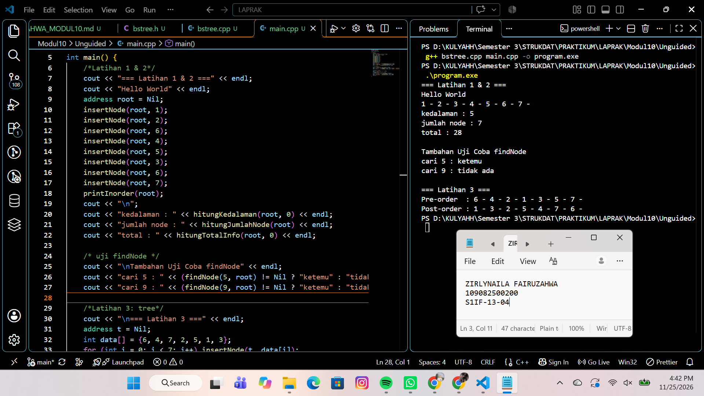

# <h1 align="center">Laporan Praktikum Modul 10 - TREE (BAGIAN PERTAMA)</h1>

<p align="center">Zirlynaila Fairuzahwa - 109082500200</p>

## Dasar Teori

Rekursif dan tree merupakan konsep dalam struktur data yang digunakan untuk menyelesaikan permasalahan pemrograman melalui pemanggilan fungsi secara berulang dan penyimpanan data berbentuk hierarki. Rekursif membantu menyederhanakan penyelesaian masalah yang memiliki pola berulang, sedangkan tree digunakan untuk mengorganisasi data berdasarkan hubungan antara simpul induk dan simpul anak. Kedua konsep tersebut dapat diterapkan dalam pengolahan dan pencarian data pada program [1][2].

### A. Rekursif<br/>

Rekursif merupakan teknik pemrograman ketika suatu fungsi atau prosedur memanggil dirinya sendiri untuk menyelesaikan permasalahan secara bertahap. Teknik ini digunakan pada permasalahan yang memiliki pola penyelesaian berulang, sehingga proses yang kompleks dapat dibagi menjadi bagian-bagian yang lebih sederhana. Penggunaan rekursif perlu memperhatikan kondisi penghentian agar pemanggilan fungsi tidak berlangsung terus-menerus [1].

#### 1. Pengertian dan Manfaat Rekursif
Rekursif adalah proses pemanggilan suatu fungsi atau prosedur oleh fungsi atau prosedur itu sendiri. Dalam pemrograman, fungsi dan prosedur termasuk subprogram yang membantu membagi program menjadi bagian-bagian yang lebih kecil. Penggunaan subprogram dapat meningkatkan keterbacaan program (readability), mempermudah pembagian program berdasarkan fungsi (modularity), serta memungkinkan bagian program digunakan kembali tanpa menuliskan perintah yang sama berulang kali (reusability). Pada rekursif, subprogram menjalankan proses pemanggilan dirinya sendiri sesuai kondisi yang telah ditentukan [1].

#### 2. Kriteria dan Kekurangan Rekursif
Subprogram rekursif harus memiliki kondisi khusus sebagai batas penghentian pemanggilan dirinya dan proses pemanggilan kembali terhadap subprogram tersebut apabila kondisi penghentian belum terpenuhi. Rekursif umumnya digunakan pada permasalahan yang memiliki langkah penyelesaian teratur. Meskipun dapat menghasilkan algoritma yang lebih singkat dan mudah dipahami, rekursif membutuhkan memori untuk menyimpan activation record dan variabel lokal serta waktu tambahan untuk menangani proses pemanggilan fungsi. Oleh karena itu, rekursif digunakan ketika penyelesaian secara iteratif sulit dilakukan atau ketika kejelasan logika program lebih diutamakan daripada efisiensi [1][2].

#### 3. Contoh dan Penerapan Rekursif
Penerapan rekursif dapat ditemukan pada perhitungan pangkat dan faktorial suatu bilangan. Pada perhitungan tersebut, fungsi memanggil dirinya sendiri dengan nilai parameter yang semakin mendekati kondisi penghentian. Rekursif juga dapat diterapkan pada proses penelusuran struktur data pohon karena setiap simpul dapat memiliki subpohon yang diproses menggunakan langkah serupa. Penggunaan rekursif pada struktur pohon membantu menyederhanakan proses penelusuran dan pengolahan simpul [2].

### B. Tree<br/>

Tree atau pohon merupakan struktur data nonlinier yang menyimpan elemen dalam bentuk hierarki. Struktur ini terdiri atas simpul-simpul yang saling terhubung melalui hubungan induk dan anak, dengan satu simpul sebagai akar. Berbeda dengan struktur data linier, seperti list, stack, dan queue, tree dapat memiliki beberapa cabang sehingga sesuai untuk menggambarkan data yang memiliki hubungan bertingkat [3].

#### 1. Pengertian, Terminologi, dan Jenis Tree
Tree merupakan struktur data yang memiliki satu simpul akar (root) dan setiap simpul selain akar mempunyai satu simpul pendahulu. Istilah yang digunakan dalam tree meliputi anak (child), orang tua (parent), lintasan (path), saudara kandung (sibling), derajat (degree), daun (leaf), simpul dalam (internal node), serta tinggi (height) atau kedalaman (depth). Jenis tree yang dibahas meliputi ordered tree, binary tree, complete binary tree, extended binary tree, binary search tree, AVL tree, dan heap tree. Pada binary tree, setiap simpul memiliki paling banyak dua anak, yaitu anak kiri dan anak kanan [3][4].

#### 2. Operasi pada Binary Search Tree
Binary Search Tree (BST) merupakan pohon biner terurut yang menempatkan nilai lebih kecil pada subpohon kiri dan nilai lebih besar pada subpohon kanan. Operasi pada BST meliputi insert untuk memasukkan simpul baru, update untuk mengubah data dengan tetap menjaga aturan BST, search untuk mencari simpul berdasarkan nilai, serta delete untuk menghapus simpul. Penghapusan dilakukan dengan memperhatikan kondisi simpul, yaitu simpul daun, simpul dengan satu anak, atau simpul dengan dua anak. BST juga memiliki simpul most-left sebagai nilai terkecil dan most-right sebagai nilai terbesar [3][4].

#### 3. Traversal dan Implementasi Tree
Traversal merupakan proses mengunjungi setiap simpul pada pohon untuk memperoleh urutan data. Pada binary tree, terdapat tiga jenis traversal, yaitu pre-order yang mengunjungi akar, subpohon kiri, kemudian subpohon kanan; in-order yang mengunjungi subpohon kiri, akar, kemudian subpohon kanan; dan post-order yang mengunjungi subpohon kiri, subpohon kanan, kemudian akar. Implementasi tree dapat menggunakan representasi linked list dengan setiap simpul memiliki informasi serta penunjuk ke anak kiri dan anak kanan. Struktur tersebut dapat digunakan untuk membuat pohon, mengalokasikan dan menghapus memori, mencari simpul, memasukkan data, serta menampilkan hasil traversal [3][4].

## Guided

### 1. Binary Search Tree

```C++
source code bst.h

#ifndef BST_H
#define BST_H
#define Nil NULL

#include <iostream>
using namespace std;

typedef struct BST *node;

struct BST
{
    int angka;
    node left, right;
};

typedef node BinTree;

bool isEmpty(BinTree tree);
void CreateTree(BinTree &tree);
node alokasi(int angka);
void dealokasi(node nodeHapus);

void insertNode(BinTree &tree, node nodeBaru);
void searchByData(BinTree tree, int angka);
void preOrder(BinTree tree);
void inOrder(BinTree tree);
void postOrder(BinTree tree);

bool deleteNode(BinTree &tree, int angka);
node mostRight(BinTree tree);
node mostLeft(BinTree tree);
void deleteTree(BinTree &tree);
int size(BinTree tree);
int height(BinTree tree);
#endif
```

Code bst.h berisi deklarasi tipe data, struktur node, serta operasi yang digunakan dalam Binary Search Tree (BST) dengan representasi pointer. Struktur BST menyimpan data integer pada angka, serta pointer left dan right untuk anak kiri dan kanan. Tipe BinTree mewakili root dari sebuah tree, dan Nil didefinisikan sebagai NULL untuk menandai node kosong. Kode ini mendeklarasikan operasi dasar (isEmpty, CreateTree, alokasi, dealokasi), operasi utama (insertNode, searchByData, deleteNode, deleteTree), penelusuran (preOrder, inOrder, postOrder), serta mostRight, mostLeft, size, dan height. Include guard BST_H mencegah file header di-include lebih dari satu kali.

```C++
source code bst.cpp

#include "bst.h"
#include <iostream>

using namespace std;
// NOTE : parameter tree disini maksudnya merujuk ke node; baik itu node root atau node lain dari tree

bool isEmpty(BinTree tree)
{
    if (tree == Nil)
    {
        return true;
    }
    else
    {
        return false;
    }
}

void createTree(BinTree &tree)
{
    tree = Nil;
}

node alokasi(int angkaInput)
{
    node nodeBaru = new BST;
    nodeBaru->angka = angkaInput;
    nodeBaru->left = Nil;
    nodeBaru->right = Nil;
    return nodeBaru;
}

void dealokasi(node nodeHapus)
{
    delete nodeHapus;
}

void insertNode(BinTree &tree, node nodeBaru)
{
    if (tree == Nil)
    {
        tree = nodeBaru;
        cout << "Node " << nodeBaru->angka << " berhasil ditambahkan ke dalam tree!" << endl;
        return;
    }
    else if (nodeBaru->angka < tree->angka)
    {
        insertNode(tree->left, nodeBaru);
    }
    else if (nodeBaru->angka > tree->angka)
    {
        insertNode(tree->right, nodeBaru);
    }
}

void searchByData(BinTree tree, int angkaCari)
{
    if (isEmpty(tree) == true)
    {
        cout << "Tree kosong!" << endl;
    }
    else
    {
        node nodeBantu = tree;
        node parent = Nil;
        bool ketemu = false;
        while (nodeBantu != Nil)
        {
            if (angkaCari < nodeBantu->angka)
            {
                parent = nodeBantu;
                nodeBantu = nodeBantu->left;
            }
            else if (angkaCari > nodeBantu->angka)
            {
                parent = nodeBantu;
                nodeBantu = nodeBantu->right;
            }
            else if (angkaCari == nodeBantu->angka)
            {
                ketemu = true;
                break;
            }
        }
        if (ketemu == false)
        {
            cout << "Data tidak ditemukan" << endl;
        }
        else if (ketemu == true)
        {
            cout << "Data ditemukan didalam tree!" << endl;
            cout << "Data Angka : " << nodeBantu->angka << endl;

            // menampilkan parentnya & pengecekan sibling
            node sibling = Nil;
            if (parent != Nil)
            {
                cout << "Parent : " << parent->angka << endl;
                if (parent->left == nodeBantu)
                {
                    sibling = parent->right;
                }
                else if (parent->right == nodeBantu)
                {
                    sibling = parent->left;
                }
            }
            else
            {
                cout << "Parent : - (node root)" << endl;
            }

            // menampilkan siblingnya
            if (sibling != Nil)
            {
                cout << "Sibling : " << sibling->angka << endl;
            }
            else
            {
                cout << "Sibling : - " << endl;
            }

            // menampilkan childnya
            if (nodeBantu->left != Nil)
            {
                cout << "Child kiri : " << nodeBantu->left->angka << endl;
            }
            else if (nodeBantu->left == Nil)
            {
                cout << "Child kiri : -" << endl;
            }
            if (nodeBantu->right != Nil)
            {
                cout << "Child kanan : " << nodeBantu->right->angka << endl;
            }
            else if (nodeBantu->right == Nil)
            {
                cout << "Child kanan : -" << endl;
            }
        }
    }
}

void preOrder(BinTree tree)
{ // tengah - kiri - kanan atau root - child kiri - child kanan
    if (tree == Nil)
    {
        return;
    }
    cout << tree->angka << " - ";
    preOrder(tree->left);
    preOrder(tree->right);
}

void inOrder(BinTree tree)
{ // kiri - tengah - kanan atau child kiri - root - child kanan
    if (tree == Nil)
    {
        return;
    }
    inOrder(tree->left);
    cout << tree->angka << " - ";
    inOrder(tree->right);
}

void postOrder(BinTree tree)
{ // kiri - kanan - tengah atau child kiri - child kanan - root
    if (tree == Nil)
    {
        return;
    }
    postOrder(tree->left);
    postOrder(tree->right);
    cout << tree->angka << " - ";
}

bool deleteNode(BinTree &tree, int angka)
{
    if (tree == Nil)
    {
        return false; // data tidak ditemukan di subtree ini
    }
    else
    {
        if (angka < tree->angka)
        {
            return deleteNode(tree->left, angka);
        }
        else if (angka > tree->angka)
        {
            return deleteNode(tree->right, angka);
        }
        else
        {
            // jika node yang mau dihapus ditemukan
            // Case 1 : node yang mau dihapus adalah leaf
            if (tree->left == Nil && tree->right == Nil)
            {
                node tmp = tree;
                tree = Nil;
                dealokasi(tmp);
            }
            // Case 2 : node yang mau dihapus hanya punya right child
            else if (tree->left == Nil)
            {
                node tmp = tree;
                tree = tree->right;
                dealokasi(tmp);
            }
            // Case 3 : node yang mau dihapus hanya punya left child
            else if (tree->right == Nil)
            {
                node tmp = tree;
                tree = tree->left;
                dealokasi(tmp);
            }
            // Case 4 : jika node yang mau dihapus punya dua child, maka ambil mostleft dari subtree kanan untuk menggantikan node yang mau dihapus
            else
            {
                // mostleft dari subtree kanan = node successor (node penerus)
                node successor = mostLeft(tree->right);
                // salin data successor ke node saat ini
                tree->angka = successor->angka;
                // hapus successor pada subtree kanan
                return deleteNode(tree->right, successor->angka);
            }
            return true; // berhasil dihapus
        }
    }
}

node mostRight(BinTree tree)
{
    while (tree->right != Nil)
    {
        tree = tree->right;
    }
    return tree;
}

node mostLeft(BinTree tree)
{
    while (tree->left != Nil)
    {
        tree = tree->left;
    }
    return tree;
}

void deleteTree(BinTree &tree)
{
    if (tree == Nil)
    {
        return;
    }
    else
    {
        deleteTree(tree->left);
        deleteTree(tree->right);
        dealokasi(tree);
        tree = Nil;
    }
}

int size(BinTree tree)
{ // mengembalikan jumlah semua node
    if (isEmpty(tree) == true)
    {
        return 0;
    }
    else
    {
        return 1 + size(tree->left) + size(tree->right);
    }
    cout << endl;
}

int height(BinTree tree)
{ // mengembalikan jumlah level tree
    if (isEmpty(tree) == true)
    {
        return -1; // tree kosong jika height = -1
    }
    else
    {
        int hl = height(tree->left);
        int hr = height(tree->right);
        int maxHeight;
        if (hl > hr)
        {
            maxHeight = hl;
        }
        else
        {
            maxHeight = hr;
        }
        return 1 + maxHeight;
    }
    cout << endl;
}
```

Code bst.cpp berisi implementasi seluruh operasi yang dideklarasikan pada bst.h. Fungsi isEmpty() mengembalikan true jika tree bernilai Nil, createTree() mengisi tree dengan Nil, alokasi() membuat node baru dengan left dan right Nil, dan dealokasi() menghapus node dengan delete. Prosedur insertNode() bekerja rekursif: jika tree Nil maka node dipasang di sana, jika angka lebih kecil maka ke kiri, jika lebih besar maka ke kanan, dan jika sama maka diabaikan. Prosedur searchByData() menelusuri tree dengan while sambil menyimpan parent, lalu jika ditemukan menampilkan data, parent, sibling, serta child kiri dan kanan. Prosedur preOrder() mencetak root - kiri - kanan, inOrder() mencetak kiri - root - kanan, dan postOrder() mencetak kiri - kanan - root. Fungsi deleteNode() mencari node secara rekursif lalu menghapusnya dengan empat kasus: leaf langsung dihapus, node dengan satu anak digantikan anaknya, dan node dengan dua anak digantikan nilainya oleh mostLeft subtree kanan. Fungsi mostRight() dan mostLeft() menelusuri anak kanan atau kiri sampai habis untuk mendapat nilai terbesar atau terkecil. Prosedur deleteTree() menghapus subtree kiri, subtree kanan, lalu node itu sendiri. Fungsi size() menghitung jumlah node, dan height() menghitung tinggi tree dengan nilai -1 untuk tree kosong.

```C++
source code main.cpp

#include <iostream>
#include "bst.h"

using namespace std;

int main()
{
    BinTree tree;
    CreateTree(tree);

    int pilih, angka;

    do
    {
        cout << "========= MENU BST =========" << endl;
        cout << "1. Insert Node" << endl;
        cout << "2. Delete Node" << endl;
        cout << "3. Search Data" << endl;
        cout << "4. Tampilkan PreOrder" << endl;
        cout << "5. Tampilkan InOrder" << endl;
        cout << "6. Tampilkan PostOrder" << endl;
        cout << "7. Size Tree (jumlah node)" << endl;
        cout << "8. Height Tree (tinggi level)" << endl;
        cout << "9. Tampilkan mostright" << endl;
        cout << "10. Tampilkan mostleft" << endl;
        cout << "11. Delete Seluruh Tree" << endl;
        cout << "0. Keluar" << endl;
        cout << "pilihan anda : ";
        cin >> pilih;
        cout << endl;

        switch (pilih)
        {
        case 1:
            cout << "Masukkan angka: ";
            cin >> angka;
            insertNode(tree, alokasi(angka));
            cout << endl;
            break;

        case 2:
            if (isEmpty(tree) == true)
            {
                cout << "Tree kosong!" << endl;
            }
            else
            {
                cout << "Masukkan angka yang ingin dihapus: ";
                cin >> angka;
                if (deleteNode(tree, angka))
                {
                    cout << "Data " << angka << " berhasil dihapus!" << endl;
                }
                else
                {
                    cout << "Data " << angka << " tidak ditemukan!" << endl;
                }
            }
            cout << endl;
            break;

        case 3:
            if (isEmpty(tree) == true)
            {
                cout << "Tree kosong!" << endl;
            }
            else
            {
                cout << "Masukkan angka yang ingin dicari: ";
                cin >> angka;
                searchByData(tree, angka);
            }
            cout << endl;
            break;

        case 4:
            if (isEmpty(tree) == true)
            {
                cout << "Tree kosong!" << endl;
            }
            else
            {
                cout << "PreOrder : ";
                preOrder(tree);
                cout << endl;
            }
            cout << endl;
            break;

        case 5:
            if (isEmpty(tree) == true)
            {
                cout << "Tree kosong!" << endl;
            }
            else
            {
                cout << "InOrder : ";
                inOrder(tree);
                cout << endl;
            }
            cout << endl;
            break;

        case 6:
            if (isEmpty(tree) == true)
            {
                cout << "Tree kosong!" << endl;
            }
            else
            {
                cout << "PostOrder : ";
                postOrder(tree);
                cout << endl;
            }
            cout << endl;
            break;

        case 7:
            cout << "Size Tree = " << size(tree) << endl;
            cout << endl;
            break;

        case 8:
            cout << "Height Tree = " << height(tree) << endl;
            cout << endl;
            break;

        case 9:
            if (isEmpty(tree) == true)
            {
                cout << "Tree kosong!" << endl;
                cout << endl;
            }
            else
            {
                cout << "Mostright : " << mostRight(tree)->angka << endl;
                cout << endl;
            }
            break;

        case 10:
            if (isEmpty(tree) == true)
            {
                cout << "Tree kosong!" << endl;
                cout << endl;
            }
            else
            {
                cout << "Mostleft : " << mostLeft(tree)->angka << endl;
                cout << endl;
            }
            break;

        case 11:
            if (isEmpty(tree) == true)
            {
                cout << "Tree kosong!" << endl;
            }
            else
            {
                deleteTree(tree);
                cout << "Seluruh tree berhasil dihapus!" << endl;
            }
            cout << endl;
            break;

        case 0:
            cout << "Keluar dari program..." << endl;
            break;

        default:
            cout << "Pilihan tidak valid!" << endl;
            break;
        }

    } while (pilih != 0);

    return 0;
}
```

Code main.cpp digunakan untuk menguji operasi BST. Program membuat tree kosong dengan CreateTree(), lalu menampilkan menu dalam perulangan do-while yang berhenti saat pengguna memilih 0. Setiap pilihan memanggil fungsi yang sesuai: pilihan 1 insert, 2 delete, 3 search, 4 sampai 6 penelusuran, 7 dan 8 size dan height, 9 dan 10 mostright dan mostleft, serta 11 hapus seluruh tree. Sebagian besar pilihan mengecek isEmpty() terlebih dahulu dan menampilkan "Tree kosong!" jika belum ada data.

## Unguided

### 1. Buatlah ADT Binary Search Tree menggunakan Linked list sebagai berikut:

```C++
source code bstree.h

#ifndef BSTREE_H
#define BSTREE_H
#define Nil NULL

#include <iostream>
using namespace std;

typedef int infotype;
typedef struct Node *address;

struct Node {
    infotype info;
    address left, right;
};

/*Latihan 1: ADT Binary Search Tree*/
address alokasi(infotype x);
void insertNode(address &root, infotype x);
address findNode(infotype x, address root);
void printInorder(address root);

/*Latihan 2: fungsi hitung*/
int hitungJumlahNode(address root);
int hitungTotalInfo(address root, int start);
int hitungKedalaman(address root, int start);

/*Latihan 3: traversal*/
void printPreorder(address root);
void printPostorder(address root);

#endif
```

```C++
source code bstree.cpp

#include "bstree.h"

address alokasi(infotype x) {
    address p = new Node;
    p->info = x;
    p->left = Nil;
    p->right = Nil;
    return p;
}

void insertNode(address &root, infotype x) {
    if (root == Nil) {
        root = alokasi(x);         
    } else if (x < root->info) {
        insertNode(root->left, x); 
    } else if (x > root->info) {
        insertNode(root->right, x);
    }
}

address findNode(infotype x, address root) {
    if (root == Nil || root->info == x) {
        return root;            
    } else if (x < root->info) {
        return findNode(x, root->left);
    } else {
        return findNode(x, root->right);
    }
}

void printInorder(address root) {
    if (root != Nil) {
        printInorder(root->left);
        cout << root->info << " - ";
        printInorder(root->right);
    }
}

int hitungJumlahNode(address root) {
    if (root == Nil) return 0;
    return 1 + hitungJumlahNode(root->left) + hitungJumlahNode(root->right);
}

int hitungTotalInfo(address root, int start) {
    if (root == Nil) return start;
    return start + root->info + hitungTotalInfo(root->left, 0) + hitungTotalInfo(root->right, 0);
}

int hitungKedalaman(address root, int start) {
    if (root == Nil) return start;
    int kiri  = hitungKedalaman(root->left,  start + 1);
    int kanan = hitungKedalaman(root->right, start + 1);
    return (kiri > kanan) ? kiri : kanan;
}

void printPreorder(address root) {
    if (root != Nil) {
        cout << root->info << " - ";
        printPreorder(root->left);
        printPreorder(root->right);
    }
}

void printPostorder(address root) {
    if (root != Nil) {
        printPostorder(root->left);
        printPostorder(root->right);
        cout << root->info << " - ";
    }
}
```

```C++
source code main.cpp

#include <iostream>
#include "bstree.h"
using namespace std;

int main() {
    /*Latihan 1 & 2*/
    cout << "=== Latihan 1 & 2 ===" << endl;
    cout << "Hello World" << endl;
    address root = Nil;
    insertNode(root, 1);
    insertNode(root, 2);
    insertNode(root, 6);
    insertNode(root, 4);
    insertNode(root, 5);
    insertNode(root, 3);
    insertNode(root, 6);
    insertNode(root, 7);
    printInorder(root);
    cout << "\n";
    cout << "kedalaman : " << hitungKedalaman(root, 0) << endl;
    cout << "jumlah node : " << hitungJumlahNode(root) << endl;
    cout << "total : " << hitungTotalInfo(root, 0) << endl;

    /* uji findNode */
    cout << "\nTambahan Uji Coba findNode" << endl;
    cout << "cari 5 : " << (findNode(5, root) != Nil ? "ketemu" : "tidak ada") << endl;
    cout << "cari 9 : " << (findNode(9, root) != Nil ? "ketemu" : "tidak ada") << endl;

    /*Latihan 3: tree*/
    cout << "\n=== Latihan 3 ===" << endl;
    address t = Nil;
    int data[] = {6, 4, 7, 2, 5, 1, 3};
    for (int i = 0; i < 7; i++) insertNode(t, data[i]);
    cout << "Pre-order  : "; printPreorder(t);  cout << endl;
    cout << "Post-order : "; printPostorder(t); cout << endl;
    return 0;
}
```

### Output Unguided 1 :

##### Output 1



Program tersebut digunakan untuk membuat sebuah Binary Search Tree (BST) dengan representasi linked list (pointer) yang menyimpan data integer, lalu menjalankan operasi insert, find, penelusuran (traversal), serta perhitungan jumlah node, total info, dan kedalaman tree. BST bekerja dengan aturan bahwa setiap node yang lebih kecil dari parent-nya diletakkan di subtree kiri, sedangkan yang lebih besar diletakkan di subtree kanan. Program dibagi menjadi tiga file, yaitu bstree.h, bstree.cpp, dan main.cpp, dan seluruh fungsi di dalamnya dibuat secara rekursif sesuai tujuan praktikum.
<br><br>
Pertama, pada bstree.h dibuat konstanta Nil yang didefinisikan sebagai NULL, tipe infotype sebagai integer, tipe address sebagai pointer ke Node, dan struct Node yang berisi info untuk menyimpan data serta left dan right untuk menunjuk anak kiri dan anak kanan. Selain itu, bstree.h berisi prototipe dari alokasi, insertNode, findNode, dan printInorder untuk Latihan 1, hitungJumlahNode, hitungTotalInfo, dan hitungKedalaman untuk Latihan 2, serta printPreorder dan printPostorder untuk Latihan 3. Seluruh isi file diapit #ifndef BSTREE_H agar file tidak ter-include dua kali.
<br><br>
Kedua, pada bstree.cpp diimplementasikan seluruh fungsi dan prosedur tersebut. Fungsi alokasi() membuat sebuah node baru dengan perintah new Node, mengisi info dengan nilai x, mengisi left dan right dengan Nil, lalu mengembalikan alamat node tersebut. Prosedur insertNode() menerima root dengan parameter referensi (address &root) agar perubahan alamat root terbawa keluar fungsi. Jika root masih Nil, berarti posisi kosong sudah ditemukan sehingga root diisi dengan hasil alokasi(x). Jika tidak, x dibandingkan dengan info pada root: jika x lebih kecil maka insertNode dipanggil kembali pada root->left, jika x lebih besar maka dipanggil pada root->right, dan jika sama maka tidak dilakukan apa-apa sehingga data duplikat diabaikan. Fungsi findNode() mengembalikan root jika root bernilai Nil (data tidak ada) atau info root sama dengan x (data ditemukan). Jika tidak, pencarian dilanjutkan ke subtree kiri bila x lebih kecil dari info root, atau ke subtree kanan bila x lebih besar. Prosedur printInorder() hanya berjalan jika root tidak Nil, yaitu mencetak subtree kiri terlebih dahulu, kemudian info root diikuti tanda " - ", lalu subtree kanan, sehingga data tampil terurut dari yang terkecil.
<br>
Ketiga, masih pada bstree.cpp, fungsi hitungJumlahNode() mengembalikan 0 jika tree kosong, dan jika tidak kosong mengembalikan 1 (untuk node itu sendiri) ditambah jumlah node subtree kiri dan subtree kanan. Fungsi hitungTotalInfo() mengembalikan nilai start jika tree kosong, dan jika tidak kosong mengembalikan start ditambah info root ditambah total info subtree kiri dan subtree kanan, dengan start 0 pada pemanggilan rekursifnya agar nilai awal tidak terhitung berulang. Fungsi hitungKedalaman() mengembalikan nilai start jika tree kosong, dan jika tidak kosong memanggil dirinya pada anak kiri dan anak kanan dengan start + 1, lalu mengembalikan nilai yang lebih besar di antara keduanya, sehingga hasilnya adalah jumlah node pada jalur terpanjang dari root. Prosedur printPreorder() mencetak info root terlebih dahulu, kemudian subtree kiri, lalu subtree kanan, sedangkan printPostorder() mencetak subtree kiri, subtree kanan, lalu info root.
<br><br>
Terakhir, pada main.cpp program menampilkan tulisan "Hello World", membuat root dengan nilai Nil, lalu memanggil insertNode(root,1), insertNode(root,2), insertNode(root,6), insertNode(root,4), insertNode(root,5), insertNode(root,3), insertNode(root,6), dan insertNode(root,7). Setelah itu program memanggil printInorder(root), kemudian menampilkan kedalaman dengan hitungKedalaman(root,0), jumlah node dengan hitungJumlahNode(root), dan total info dengan hitungTotalInfo(root,0). Program juga menguji findNode dengan mencari angka 5 dan angka 9, lalu menampilkan "ketemu" jika alamat yang dikembalikan bukan Nil dan "tidak ada" jika Nil. Untuk Latihan 3, program membuat tree baru t dan menyisipkan data 6, 4, 7, 2, 5, 1, 3 dengan perulangan for, lalu memanggil printPreorder(t) dan printPostorder(t).
<br><br>
Sebagai contoh, pada Latihan 1 dan 2 insertNode(root,1) membuat 1 menjadi root. insertNode(root,2) menempatkan 2 di kanan 1 karena 2 lebih besar dari 1. insertNode(root,6) menempatkan 6 di kanan 2. insertNode(root,4) lebih besar dari 1 dan 2 tetapi lebih kecil dari 6, sehingga 4 menjadi anak kiri 6. insertNode(root,5) menjadi anak kanan 4 karena lebih besar dari 4, sedangkan insertNode(root,3) menjadi anak kiri 4 karena lebih kecil dari 4. insertNode(root,6) yang kedua diabaikan karena 6 sudah ada, dan insertNode(root,7) menjadi anak kanan 6. Dengan demikian printInorder(root) menampilkan 1 - 2 - 3 - 4 - 5 - 6 - 7 - . Jalur terpanjang pada tree ini adalah 1, 2, 6, 4, 5 sehingga kedalaman bernilai 5. Jumlah node adalah 7 karena dari 8 kali insert terdapat 1 data duplikat, dan total info adalah 1 + 2 + 3 + 4 + 5 + 6 + 7 = 28.
<br>
Sebagai tambahan, saya melakukan pengujian findNode, angka 5 ditemukan melalui jalur 1, 2, 6, 4, 5 sehingga ditampilkan "cari 5 : ketemu", sedangkan angka 9 menelusuri jalur 1, 2, 6, 7 lalu berhenti di Nil sehingga ditampilkan "cari 9 : tidak ada".
<br>
Pada Latihan 3, penyisipan 6, 4, 7, 2, 5, 1, 3 membentuk tree dengan 6 sebagai root, 4 dan 7 sebagai anak 6, 2 dan 5 sebagai anak 4, serta 1 dan 3 sebagai anak 2, sesuai dengan Gambar 10-18. Pada penelusuran pre-order, program mencetak root lebih dulu lalu ke kiri dan ke kanan sehingga ditampilkan 6 - 4 - 2 - 1 - 3 - 5 - 7 - . Pada penelusuran post-order, program mencetak kiri, kanan, lalu root sehingga ditampilkan 1 - 3 - 2 - 5 - 4 - 7 - 6 - . Dengan demikian, program berhasil membuat BST, menyisipkan dan mencari data, menolak data duplikat, menghitung jumlah node, total info, dan kedalaman tree, serta menampilkan isi tree secara in-order, pre-order, dan post-order secara rekursif. 

## Kesimpulan

Berdasarkan pembahasan mengenai rekursif dan tree, dapat disimpulkan bahwa rekursif merupakan teknik pemrograman yang menggunakan pemanggilan fungsi terhadap dirinya sendiri untuk menyelesaikan permasalahan secara bertahap. Penggunaan rekursif membutuhkan kondisi penghentian agar proses tidak berlangsung terus-menerus. Sementara itu, tree merupakan struktur data nonlinier yang menyimpan data dalam bentuk hierarki melalui hubungan antara simpul induk dan simpul anak. Salah satu penerapannya adalah Binary Search Tree (BST), yang menyusun data berdasarkan aturan nilai lebih kecil ditempatkan pada subtree kiri dan nilai lebih besar ditempatkan pada subtree kanan. BST dapat digunakan untuk melakukan penyisipan, pencarian, serta penelusuran data dengan metode in-order, pre-order, dan post-order.
<br>
Pada praktikum ini, saya telah membuat Binary Search Tree menggunakan representasi linked list dengan tiga file, yaitu bstree.h, bstree.cpp, dan main.cpp. Implementasi dilakukan menggunakan pointer dan fungsi rekursif untuk mengalokasikan node, menyisipkan data, mencari data, serta menampilkan isi tree. Praktikum juga mencakup fungsi untuk menghitung jumlah node, total informasi, dan kedalaman tree. Berdasarkan pengujian, program dapat menyusun data sesuai aturan BST, mengabaikan data duplikat, menemukan data yang tersedia, serta memberikan hasil pencarian ketika data tidak ditemukan. Selain itu, traversal in-order menghasilkan data secara berurutan, sedangkan pre-order dan post-order menampilkan data berdasarkan urutan kunjungan masing-masing. Dengan demikian, praktikum ini memberikan pemahaman mengenai penerapan konsep rekursif dan struktur data tree dalam pembuatan serta pengolahan Binary Search Tree.

## Referensi

[1] Asnawi, C., & Setiawan, C. B. (2010). Perancangan fungsi terbilang generik menggunakan teknik rekursi. Teknomatika: Jurnal Informatika dan Komputer, 3(1), 79–90. https://ejournal.unjaya.ac.id/index.php/teknomatika/article/view/368
<br>
[2] (2025). Perbandingan pemanfaatan algoritma rekursif dan iteratif dalam penyelesaian struktur data pohon. MIFORTEKH, 5(1), 46–56. https://journal.stiestekom.ac.id/index.php/mifortekh/article/download/742/558/2306
<br>
[3] Malau, E., & Sirait, H. P. (2021). Implementasi teknik Binary Search Tree pada pencarian data penduduk. KAKIFIKOM (Kumpulan Artikel Karya Ilmiah Fakultas Ilmu Komputer), 3(2), 87–94. https://doi.org/10.54367/kakifikom.v3i2.1794
<br>
[4] Suwanty, S., & Pribadi, O. (2016). Metode AVL Tree untuk penyeimbangan tinggi Binary Tree. Jurnal TIMES, 4(2), 61–65. https://doi.org/10.51351/jtm.4.2.2015240
<br>
[5] Modul 10 Struktur Data. Tree (Bagian Pertama), Materi Praktikum Struktur Data.